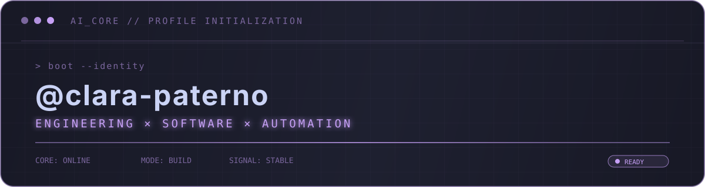

  

Hi! I'm Clara, a **Computer Engineering student** and **Full-Stack Developer Intern at VORTEX**, curious about technology and passionate about learning by building things.

I enjoy exploring different areas of technology and challenging myself with new projects — from **software development and mobile applications to embedded systems, electronics, and IoT**.

🌱 Always learning and exploring new technologies  
💻 Turning ideas into real-world projects  
🔎 Interested in different areas of engineering and technology  
🚀 Growing as a developer through hands-on experience

## 🌐 Socials

## 💻 Tech Stack:

## 📊 GitHub Stats

  

<!-- Proudly created with GPRM ( https://gprm.itsvg.in ) -->
